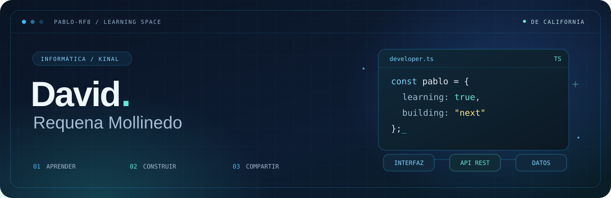

<!-- Perfil académico de Pablo-Rf8. Guía: docs/profile-design.md -->

# Hola, soy Pablo Requena 👋

**Pablo David Requena Mollinedo · `Pablo-Rf8`**

  
  
  

 

[Sobre mí](#user-content-sobre-mi) &nbsp; · &nbsp; [Stack](#user-content-stack) &nbsp; · &nbsp; [Proyectos](#user-content-proyectos) &nbsp; · &nbsp; [Actividad](#user-content-actividad) &nbsp; · &nbsp; [Contacto](#user-content-contacto)

---

## 🎓 Aprender construyendo

Tengo **19 años** y estudio Informática en el **Centro Educativo Técnico Laboral Kinal, Guatemala**. Este es el espacio donde comparto mis prácticas, actividades y proyectos académicos mientras me preparo para mis **prácticas profesionales de TI**.

- **Desarrollo Full Stack:** bases de datos, APIs REST y diseño de interfaces.
- **Trabajo en equipo:** experiencia como **Scrum Master** en proyectos estudiantiles, gestionando repositorios y tableros de Trello.
- **Hardware y redes:** diagnóstico, mantenimiento de equipos y configuración de redes.

> Me interesa entender el problema, construir una solución y aprender de cada iteración.

### Dos cuentas, el mismo Pablo

📘 **Aquí, en Pablo-Rf8:** mi formación y proyectos académicos. 
👻 **En [0ghost8](https://github.com/0ghost8):** mis proyectos personales, experimentos e identidad visual.

## 🧰 Tecnologías que pongo en práctica

**Frontend**

<picture>
  <source media="(prefers-color-scheme: dark)" srcset="https://skillicons.dev/icons?i=angular%2Cts%2Cjs%2Chtml%2Ccss&amp;theme=dark&amp;perline=6" />
  <source media="(prefers-color-scheme: light)" srcset="https://skillicons.dev/icons?i=angular%2Cts%2Cjs%2Chtml%2Ccss&amp;theme=light&amp;perline=6" />
  
</picture>

**Backend y datos**

<picture>
  <source media="(prefers-color-scheme: dark)" srcset="https://skillicons.dev/icons?i=java%2Cspring%2Cnodejs%2Cexpress%2Cmysql%2Ccpp&amp;theme=dark&amp;perline=6" />
  <source media="(prefers-color-scheme: light)" srcset="https://skillicons.dev/icons?i=java%2Cspring%2Cnodejs%2Cexpress%2Cmysql%2Ccpp&amp;theme=light&amp;perline=6" />
  
</picture>

**Herramientas**

<picture>
  <source media="(prefers-color-scheme: dark)" srcset="https://skillicons.dev/icons?i=git%2Cgithub%2Cdocker%2Cpostman&amp;theme=dark&amp;perline=6" />
  <source media="(prefers-color-scheme: light)" srcset="https://skillicons.dev/icons?i=git%2Cgithub%2Cdocker%2Cpostman&amp;theme=light&amp;perline=6" />
  
</picture>

  
  
  
  

## 🗂️ Proyectos y prácticas

<table>
<tr>
<td width="50%" valign="top">

### 🖥️ Vistas

**Interfaces web en práctica.**

Proyecto con Angular para trabajar en la construcción de vistas y presentación de una aplicación web.

`Angular` `TypeScript` `SCSS`

[Explorar proyecto →](https://github.com/Pablo-Rf8/Vistas)

</td>
<td width="50%" valign="top">

### 🛒 Carrito de ventas

**Aprender desarrollando.**

Actividad académica con un proyecto de carrito de ventas, dentro de mis prácticas de desarrollo con TypeScript.

`TypeScript` `Desarrollo web`

[Explorar proyecto →](https://github.com/Pablo-Rf8/ACT3-B4-PabloRequena)

</td>
</tr>
</table>

| Más de mi formación | Repositorio |
| :--- | :--- |
| 🌐 **Actividad Integradora** | [Actividad-Integradora-PabloRequena](https://github.com/Pablo-Rf8/Actividad-Integradora-PabloRequena) · Trabajo académico de desarrollo web en HTML. |
| 🧩 **Prácticas de TypeScript** | [ACT1-B4-de-PabloRequena](https://github.com/Pablo-Rf8/ACT1-B4-de-PabloRequena) y [ACT2-B4bypablorequena](https://github.com/Pablo-Rf8/ACT2-B4bypablorequena). |
| ♻️ **EcoPlaca** | [Proyecto en mi cuenta personal](https://github.com/0ghost8/EcoPlaca) · Reciclaje de basura electrónica y reutilización de hardware. |
| 🐾 **Coda Garo** | [Proyecto en mi cuenta personal](https://github.com/0ghost8/CODA-GARO) · Plataforma de adopción de mascotas. **Rol: Scrum Master.** |

  <a href="https://github.com/Pablo-Rf8?tab=repositories"><b>Explorar mis repositorios académicos ↗</b></a>

## 📈 Mi actividad académica en GitHub

  
  

Datos públicos de esta cuenta · Los lenguajes reflejan el código de mis repositorios.

## 🤝 Conectemos

Me interesa compartir ideas sobre **desarrollo, hardware y trabajo en equipo**.

- **Correo:** [pablodrequena@gmail.com](mailto:pablodrequena@gmail.com)
- **Perfil personal:** [0ghost8 — proyectos y experimentos](https://github.com/0ghost8)
- **Discord:** [Encuéntrame aquí](https://discord.com/users/784500933202542644)

### Aprender. Construir. Compartir.

Cada proyecto es una oportunidad para hacerlo mejor.

[Volver arriba ↑](#user-content-inicio)

 

Visuales con <a href="https://skillicons.dev/">Skill Icons</a>, <a href="https://shields.io/">Shields.io</a>, <a href="https://github.com/DenverCoder1/readme-typing-svg">Typing SVG</a>, <a href="https://github.com/kyechan99/capsule-render">Capsule Render</a> y <a href="https://github.com/anuraghazra/github-readme-stats">GitHub Readme Stats</a>.

